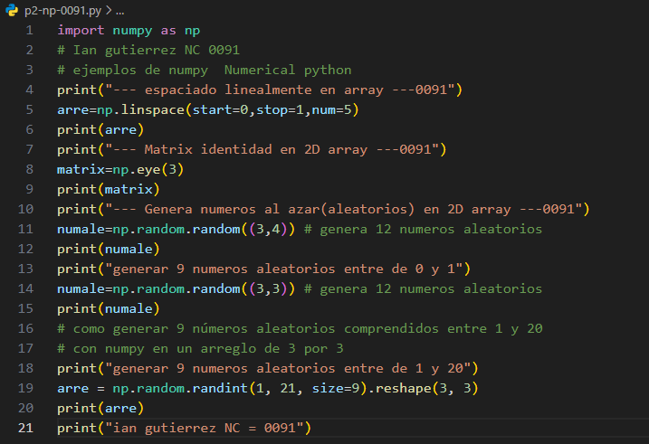
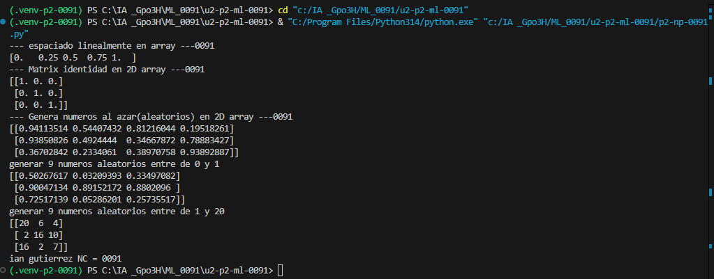

start=0: Indica el valor inicial de la secuencia.

stop=1: Indica el valor final de la secuencia.

num=5: Indica la cantidad de números que se van a generar.

## que es np.linspace
linspace es una función de NumPy que genera una cantidad determinada de números distribuidos uniformemente entre un valor inicial y uno final.

##  el codigo

## resultado

